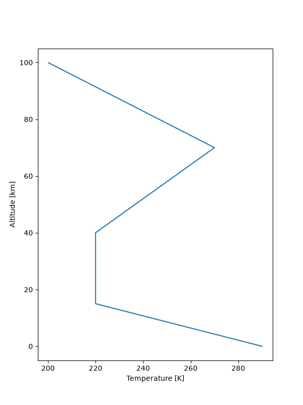
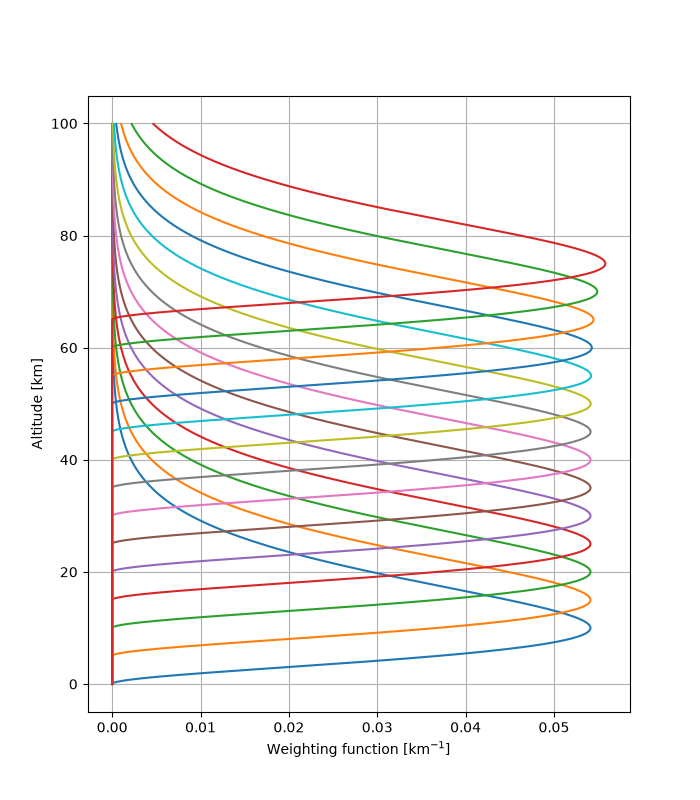
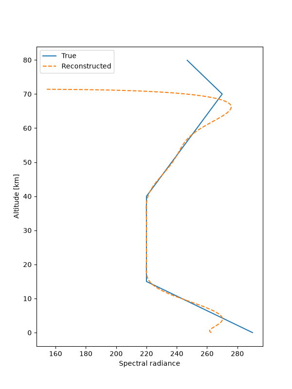

# Introduction

Remote or indirect measurements are used for a plethory of purposes, from investigating the structure of the atom to the expanse of the universe and everything in between. Remote measurement methods oftern bring their own wake of complex problems in their interpretation, known as inverse problems. The Rodgers (2000) textbook is a seminal paper discussing inverse problems particularly in the context of atmospheric soundings. 

*Inverse Theory* refers to the inversion of complicated functions. The typical atmospheric example is one in which electromagnetic radiation emerging from an atmosphere or planetary system is measured, and needs to be inverted to recover the desired temperature, concentration, or other variable that is desired. 

## 1.1 The Beginnings 

The concept of atmospheric inverse problems was first began around the 1920's when Dobson started making measurements of Ozone in the stratosphere using ground based UV spectrometers (recall the Dobson unit for measuring ozone), giving insight to the total  column amounts of Ozone. This was developed further, using the Rayleigh scattering of sunlight as it was setting, profiles (vertical distributions) of Ozone could be recovered. 

With the advent of meteorological satellites it become clear that remote sensing would play a paramount role in determining the global state of the atmosphere. Kaplan (1959) proposed that the vertical distribution of temperature in the atmosphere could be determined globally using remote sensing. Exploiting the infrared spectrum, and the thermal emission of the atmosphere. This grew the field of *inverse theory* tremendously.

## 1.2 Atmospheric Remote Sounding Methods

Remote sounding of the atmosphere has been carried out by a wide variety of instruments, using a plethora of different measurement principles. But fundamentally nearly all exploit the electromagnetic spectrum to some degree (though of course, different regimes in the spectrum will be used for different cases). Physical effects like refractions, absorption, transmittance, scattering, thermal emission, and non-thermal emission of radiation may give key insights to atmospheric variables we are interested in. 

Over the decades, an arsenal of instrumentation has also been developed: Michelson interferometers, Fabry-Perot etalons, filter radiometers, gas correlation methods, microwave- and radiowave receivers, and more. Most methods are passive, meaning they observe incident radition originating naturally from the environment; while others may be active, they produce electromagnetic radiation and measure the impacted wave after it interacts with the environment (scattered, absorbed, etc). 

### 1.2.1 Thermal Emission Nadir and Limb Sounders

Thermal emission in infrared and microwave are probably the most ubiquitous quantities measured. Every part of the atmosphere emits, and the details of the emission spectrum depend on the molecules present in very distinctive ways. Almost every unique molecule has a distinct characteristic specral signature in the infrared or microwave, which can make the identification of gases much simpler. 

Nadir sounds are those that measure emissions from a narrow field of view in a *broadly* downward direction. This geometry allows for decent spatial resolution, but can limit the vertical resolution (to the order of several kilometers). This can be amended somewhat with *near*-nadir viewing geometries, where the slant angle in the obversing satellite can improve vertical resolution. 

Limb sounders look through the edge of the atmosphere, the view is projected through the atmosphere to outerspace (ie, never looks at the ground). Limb sounders can scan through vertical layers of the atmosphere very effectively. They therefore, perhaps expectedly, have the inverse trade-off compared to nadir, where the spatial horizontal resolution is poor (hundreds of kilometers), but there is very high vertical resolution. 

Naturally, when designing missions, line-of-sight is a critical consideration. And the spatial-horizontal resolution trade-off is decided depending on what kind of variable you are interested in measuring. 

Example: ammonia plumes from factory emissions. Would probably need nadir geometry, high horizontal resolutions lets you pinpoint where ammonia emissions are being emitted from (ie, find the factory). While the altitude is of secondary importance, we already know it will be near the surface, as the ammonia will be emitted by the factory at the surface.

Counter Example: distrubution of atomic oxygen in mesophere. Would prefer limb geometry. We want to recover what profiles of atomic oxygen looks like in the mesophere, so vertical resolution is very important, and takes precidence over horizontal resolution. 

## 1.2.2 Scattered Solar Radiation

Scattered solar radiation is significantly more intense than emission from the atmosphere. This can be beneficial, as the higher intensity could be more measurable for instrumentation... of course it is only available during daylight hours, and otherwise very dependent on the sun geometry (sun angle, incident angle on the surface, difference in angle between the incident solar beam and the observer, etc). Additionally, solar radiation is peaked in ranges of the spectrum where most atmospheric quantities are less active, less absorption and emission from gas quantities in vis and UV. Of course, some still exist, things like atomic oxygen, ozone, NOx (in many cases). But the main advantage of scattered solar is the observation of clouds and aerosol quantities. 

### 1.2.3 Absorption of Solar Radiation

The first remote measurement of the atmospheric composition was the total ozone amount using absorption of solar radiation. The same principle can be used from the surface for a wide variety of gases, particularly in the infrared and microwave spectra where many constituents have absorption lines and bands. 

Information about profiles can be obtained if pressure-broadened absorption lines are well resolved. We can infer from the broadening the pressure level the constituent is found at, and we know the pressure profile of the atmosphere. From this it's "trivial" to obtain the profile. 

It's common to apply Fourier Transform Infrared Spectrometers (FTIR) as a ground based measurement instumentation to derive profiles of different constituent gases. Can be favored due to low cost compared to space-based remote sensing options. 

### 1.2.4 Active Techniques

Rodgers (2000) doesn't have a lot of active sensor comments to share, perhaps because of the time it was published, since then there have been many more developed. 

*Radio Occultation* exploit the phase delay of GPS signals due to the atmosphere to derive characteristics about the atmosphere. Things like the concentration of water vapor has effects on the refractive index of the air, which can be observed and used to infer column distrubtions of water vapor. 

*Sound propagation* A method which was significant in the 1960s, the grenade sonde. A sequence of grenades were released from a sounding rocket to explode at different altitudes. The time of flight of the sound puls to an array of microphones on the surface could be measured, to then calculate the speed of sound as a function of altitude (which can then be used to recover atmosphere characteristics). 

*Lidar* Stands for light detection and ranging. Involves the measurement of backscatter from a pulsed laser pointed (usually) upwards from the surface (at least it was back then, now its used in many ways). The backscatter from lidar can be used as a useful signal to infer things about the atmosphere. Similar story for radar. 

## 1.3 Simple Solutions to Inverse Problems

We can find simple cases for inverse theory, like recovering a simple profile of temperature (shown below).

This is the case where the influence of clouds and other absorbers can be safely ignored, such that the radiative transfer equation decomposes to:

$$
L(\nu) = \int^{\infty}_{0}B[\nu, T(z)]\frac{d\tau(\nu,z)}{dz}dz
$$

Where $B[\nu, T(z)]$ is the Planck function, calculating radiance as a function of temperature. For the sake of simplicity in this example, ground emission is zero, its just atmospheric contributions. Secondly, consider taking measurements at a close spectral interval such that the wavenumber variability of radiance can be ignored (ie, we just fix the wavenumber). This reduces the problem further to:

$$
L(\nu_i) = \int^{\infty}_{0}B[\bar{\nu}, T(z)]K_i(z)dz
$$

where $K_i(z) = \frac{d\tau(\bar{\nu}, z)}{dz}$ and is known as the weighting function(s). Usually the weighting functions will be informed by the sensor, RTM, prior knowledge, observations etc. For now we just make them up. We create a set of them centered at different heights to essentially construct a measurement space, like the one illustrated here:

The equation is now linear in $B[T(z)]$ which is our unknown we'd want to recover. Fundamentally, we can conclude that if $B[T(z)]$ is found, we can recover the profile of temperature. 

Solving the equation above is clearly going to be a challenge. Not least of which is the fact that there are a finite number of measurements to solve a continuous unknown (the problem is ill-posed). We therefore deconstruct the continuous $B[\bar{\nu}, T(z)]$ to a basis, using polynomial, sin, cos, whatever you'd like (although polynomial tends to be the best suited).

$$
B(\bar{\nu}, T(z)) = \sum_{j=1}^{m}w_jW_j(z)
$$

Substituting back into the equation of interest we get:
$$
L_i = \sum_{j=1}^{m}w_j \int_{0}^{\infty}W_j(z)K_i(z)dz = \sum_{j=1}^{m}C_{ij}w_j
$$

Defining the matrix C as $C_{ij}=\int_{0}^{\infty}W_j(z)K_i(z)dz$, which can be easily calculated. It thus follows that we have a set of m equations with m unkowns, the problem can be solved. It then also follows that:

$$
B(\bar{\nu}, T(z)) = \sum_{i,j}W_j(z)C^{-1}_{ji}L_i
$$

We can use this to recover our temperature profile:

Unfortunately, this problem set-up tends to be terribly ill-conditioned in many (most) practical applications. Consequently any error or uncertainty will be monumentally amplified and the solution will be meaningless. Perhaps thankfully so, otherwise the rest of the book would be unneeded. 