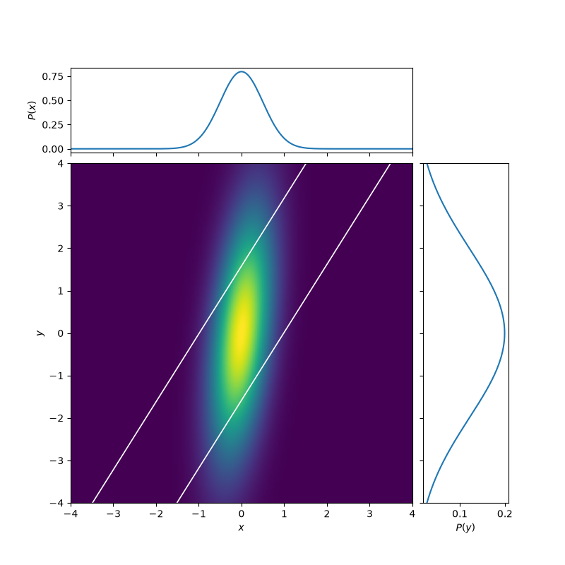

# Bayes' Theorem

A lot of Rodgers 2000 relies on Bayesian inference, and the communication of two random variables (the state and measurement space). It's pretty important, therefore, to have an understanding of Bayes' Theorem beyond the basics. Rodgers gives a breakdown, these are those notes. 

Probability density is a scalar-valued function, in our case a a function of the state vector or the measurement vector. 

$P(\vec{x})$ is the prior probability distribution function of the state vector $\vec{x}$. This means the quantity $P(\vec{x})d\vec{x}$ is the probability before the measurement that $\vec{x}$ lies in the multidimensional volume $(\vec{x}, \vec{x} + d\vec{x})$, expressing quantitatively our knowledge of $\vec{x}$ before the measurement is mad. It is normalized such that $\int P(\vec{x})d\vec{x}=1$. 

$P(\vec{y})$ is the prior probability distribution function of the measurement, with a similar meaning as $P(\vec{x})$. This is the probability distribution function of the measurement *before it is made*.

$P(\vec{x},\vec{y})$ is the joint distribution of vectors $\vec{x}$ and $\vec{y}$. Meaning that $P(\vec{x},\vec{y})d\vec{x}d\vec{y}$ is the probability that $\vec{x}$ lies in $(\vec{x}, \vec{x} + d\vec{x})$ **and** $\vec{y}$ lies in $(\vec{y}, \vec{y} + d\vec{y})$.

$P(\vec{y}|\vec{x})$ is the conditional probability of $\vec{y}$ given $\vec{x}$, meaning that $P(\vec{y}|\vec{x})d\vec{y}$ is the probability that $\vec{y}$ lies in $(\vec{y}, \vec{y} + d\vec{y})$ for a given $\vec{x}$.

Inversely, $P(\vec{x}|\vec{y})$ is the opposite, the state given a measurement. Note that this is the question we try to ask in inverse problems regarding the atmosphere (typically). 

It might seem a bit odd to use the same symbol P for all of these different functions, but in each case the argument makes it clear which probability density function we are reffering to, convention eliminates the need for clarifying subscripts. 

The figure above illustrates the concepts outlined. $P(\vec{x})$ and $P(\vec{y})$ are detailed as probability density functions with respect to the state or measurement vectors respectively. They also define the shared joint distribution illustrated as the heatmap. The contour overlaid on the heatmap represents $(P(\vec{y}\mid\vec{x}) = P(\vec{x},\vec{y})/P(\vec{x}))$, illustrating the conditional probability density of the measurement vector given the state vector.

## More Definitions

We can find the probability of one variable by integrating across the domain of the other. 

$$
P(x) = \int _{-\infty}^{\infty}P(x,y)dy
$$

or 

$$
P(y) = \int _{-\infty}^{\infty}P(x,y)dx
$$

The conditional distribution $P(y|x)$ is proportional to the values of $P(y,x)$ as a function of $y$ for a given value of $x$. The constant of proportionality is such that $\int P(y|x)dy=1$, so $P(y,x)$ ought to be divided by the integral along the line.

$$
P(y|x) = \frac{P(x,y)}{\int P(x,y)dy}
$$

Thus, as we know $\int P(x,y)dy=P(x)$, we can thus find:

$$
P(y|x) = \frac{P(x,y)}{P(x)}
$$

And inversely, the same is true for $P(x|y)=\frac{P(x,y)}{P(y)}$. From the two equations, we can eliminate the joint distributions to derive Bayes' theorem.

$$
P(\vec{x}|\vec{y}) = \frac{P(\vec{y}|\vec{x})P(\vec{x})}{P(\vec{y})}
$$

