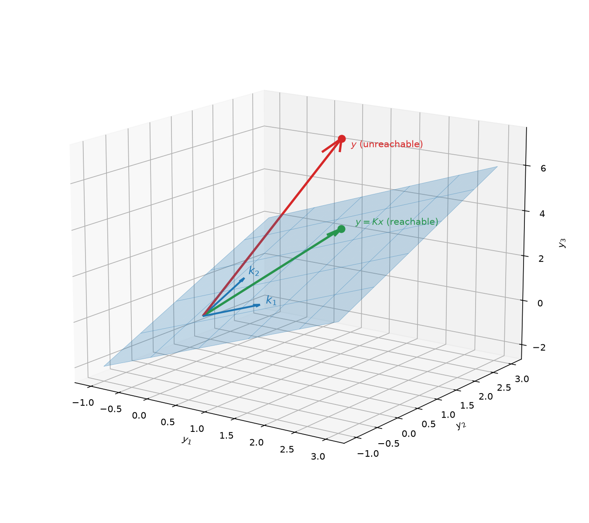
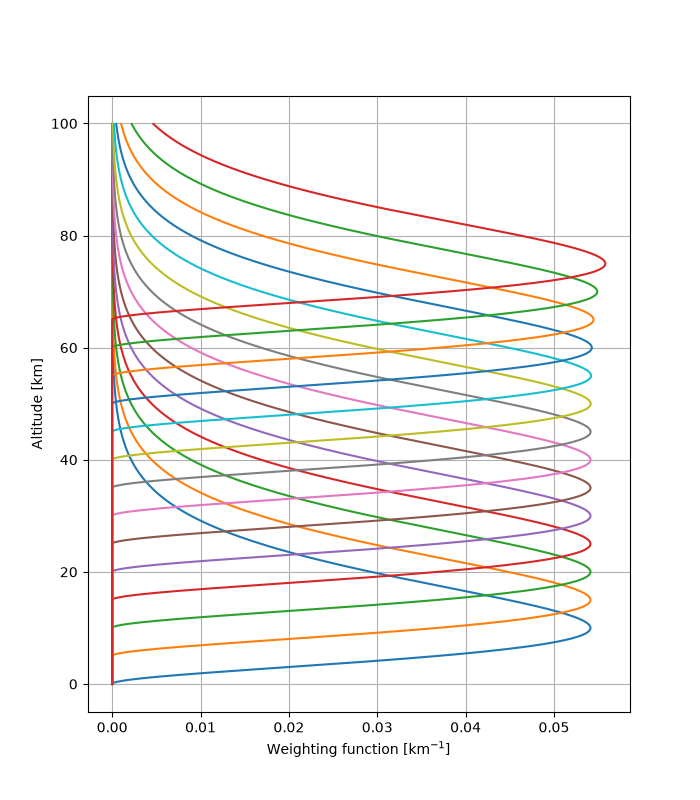
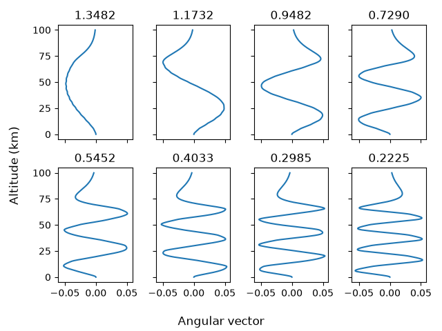

# Chapter 2: Information Aspects

Inverse problems can be deceptively tricky, often being ill-conditioned, ill-posed, and often non-linear. To gain appreciation of these nuances, we need to first understand the density and characteristics of information in signals. 

## 2.1 Formal Statement of the Problem

Inverse problems are a question of setting up and solving a set of linear (or non-linear) equations, in the present of experimental error in its parameters. 

To examine the information content of the indirect measurement, we consider the measurements to be assembled into a *measurement vector*, namely $\vec{y}$. The measurement vector $\vec{y}$ and the *state vector* of unknowns $\vec{x}$ are related through this set of equations, usually through the relation of some forward model (which may or may not be linear), modulated by some measurement error $\epsilon$

$$
\vec{y} = \mathbf{F}(\vec{x}) + \epsilon
$$

To construct a forward model we must of course know how the measuring device works, and understand how the measurement relates to the variable we retrieve. 

A forward model could be as simple as the Planck function, relating the temperature of an object to the radiation it emits.

### Weighting Function Matrix

For the purpose of examing the information content of a measurement, it is most convenient to consider a linear problem. A linearization of a forward about some reference state $\vec{x_0}$ can be adequate for this purpose, provided the forward model is linear within the error bounds of the retrieval. 

$$
\vec{y} - \mathbf{F}(\vec{x_0}) = \frac{\partial\mathbf{F}(\vec{x})}{\partial\vec{x}}(\vec{x} - \vec{x_0}) + \epsilon = \mathbf{K}(\vec{x} - \vec{x_0}) + \epsilon
$$

This defines the weighting function matrix $\mathbf{K}$, which may not be square. Each element of $\mathbf{K}$ is the partial derivative of the forward model element with respect to the state vector element.

### Vector Spaces

The concept of linear vector spaces is useful in the context of lineaer equations. 

The *state space* or the model space is a vector space of dimension $n$, within which each conceivable state is represented by a point, or equivalently a vector from the origin to that point. 

The *measurement space* (or data space) is a vector space of dimension $m$ in which every conceivable measurement is likewise represented by a point or a vector. 

Consequently, we can consider measurement to be a mapping from the state space to the measurement space, and the inverse problem to be a mapping from the measurement space onto the state space. 

This makes the weighting function matrix $\mathbf{K}$ to be $(m \times n)$ and represents the forward mapping from state to measurement space (with error $\epsilon$). 

*The mapping if fuzzy, to an extent determined by the error measurement statistics*

Imagine a case in which a state space is defined in two dimensions. If three measurements are made, corresponding to three vectors $\vec{k_1}$, $\vec{k_2}$ and $\vec{k_3}$, the measurements $\vec{y_1}$, $\vec{y_2}$ and $\vec{y_3}$ are the orthogonal projections of $\vec{x}$ onto $\vec{k}$'s. Trivially the measurement is overconstrained.

In this example the measurement space is three dimensional, but the state space maps onto a subspace of the measurement space (a 2D plane), as one measurement is always a function of the other two. In the absence of measurement error, there will be points in the measurment space that fall out of the subspace (observe diagram). There correspond to impossible state vectors. 

## 2.2 Linear Problems without Measurement Error

Consider an arbitary problem of any dimension in the absense of measurement error, as discussed this reduces our problem to:

$$
\vec{y} = \mathbf{K}\vec{x}
$$

And involves determining whether there are no solutions, one solution, or infinite solutions. More generally, we are interested in investigating what information can be extracted from measurements $\vec{y}$ about the state $\vec{x}$ particularly when there is no solution or no unique solution. 

### Subspaces of state space

The $m$ weighting function vectors contained in $\mathbf{K}$ will span some subspace of the state space, which will be of dimension $\leq m$, less should the vectors not be linearly independent. 

The dimension of this subspace is called its *rank*. The rank of $\mathbf{K}$, denoted by $p$, is equal to the number of linearly independent rows or columns. Even when $m>n$, more measurements than unknowns, the rank cannot be greater than $n$ and could be less. 

We can imagine an orthogonal coordinate system (or *basis*) for state space which has $p$ orthogonal base vectors in row space, and $n-p$ base vectors outside which are orthogonal to all the weighting function vectors. Only components of the state vector which lie in the row space will contribute to the measurement vector, all other components being orthogonal to it don't contribute at all. This undetermined contribution is the *null space* of $\mathbf{K}$. 

The problem will be fundamentally underdetermined if $p<n$ (i.e., a null space exists). In such cases there is not a unique solution, because there are components of the state which don't contribute to the measurements and can therefore be any value. There are therefore infinite values. 

*If a retrieved state has components which lie in the null space, their values cannot have been obtained from the measurements*

Inversely, a problem will be over-determined if $m>p$ and there are more measurements than the rank of $\mathbf{K}$. Or well-determined if $m=p$, the measurements are equal to the rank. It can be possible, therefore, for a problem to be simultaneously over- and under-determined with respect to the row space and null space. These are mixed-determined problems. 

Well-determined problems have unique solutions, found by solving a set of $p\times p$ equations. Over-determined problems (in the absence of measurement error) will have either measurements necessarily being linearly dependent or there are no exact solutions that exist. 

**In summary, the measurement represented by $\mathbf{K}$ provides not more than $p$ pieces of information with which to describe the state**

### Identifying the null space and the row space

The row space of a given weighting function matrix $\mathbf{K}$ can be found by finding a basis, or coordinate system, for state space of orthogonal sets of vectors. This makes it a bit tricky, as there are infinite ways of doing this. And any rotation of a valid orthogonal set is another valid basis. We can take the singular value decomposition to help us out. 

$$
\mathbf{K} = \mathbf{U}\mathbf{\Lambda}\mathbf{V}^T
$$

Where $\mathbf{U} (m\times p)$ and $\mathbf{V} (n \times p)$ are matrixes of its left and right singular vectors and $\mathbf{\Lambda}$ is a diagonal matrix of singular values of size $(p \times p)$; where $p$ is the rank of the matrix $\mathbf{K}$. 

Recall our synthetic weighting function matrix $\mathbf{K}$ from the introduction. The altitude dimension was set at $1000$, and there are $14$ measurement points, i.e., $m \times n = 14 \times 1000$, the size of our matrix $\mathbf{K}$

We can take the singular valude decomposition of this matrix and investigate the singular vectors. Below are the first 8 singular vectors, with the singular values printed as titles.

The $p$ columns of $\mathbf{V}$ for the desired orthogonal basis for the row space and the columns of $\mathbf{U}$ for a corresponding basis in measurement space. 

We can inset the singular value decomposition into our forward model and multply by $\mathbf{U}^T$:

$$
\vec{y} = \mathbf{K}\vec{x} \\
\vec{y} = \mathbf{U}\mathbf{\Lambda}\mathbf{V}^T \vec{x} \\
\mathbf{U}^T\vec{y} = \mathbf{\Lambda}\mathbf{V}^T\vec{x} \\
$$

Then defining $\vec{y}' = \mathbf{U}^T\vec{y}$ and $\vec{x}' = \mathbf{V}^T\vec{x}$. We can obtain

$$
\vec{y}' = \mathbf{\Lambda}\vec{x}'
$$

indicating that the $p$ transformed measurements $\vec{y}'$ in column space are each proportional to a component of the transformed state space $\vec{x}'$ in p-dimensional row space. The matrix $\mathbf{V}$ forms a natural basis for row space, closely related to the $\mathbf{U}$ matrix basis for column space. 

# 2.3 Linear Problem with Measurement error

All real measurements will be subject to some degree of experimental error or noise. Consequently any retrieval method must account for this error and uncertainty in the procedure. 

It's common to present noise through the use of probability distribution functions, using a Bayesian framework: $P(y)$ with mean $\bar{y}$ and error $\sigma$

$$
\bar{y} = \int yP(y)dy
$$

$$ 
\sigma^2 = \int (y - \bar{y})^2P(y)dy
$$

Where $P(y)dy$ is the probability that y lies in the range $(y, y+dy)$. 

The probability distribution function is almost always taken to be gaussian or normal. 

$$
P(y) = \mathcal{N}(y-\bar{y}, \sigma) = \frac{1}{\sqrt{2\pi}\sigma}\exp \left[ -\frac{(y-\bar{y})^2}{2\sigma^2}\right]
$$

This is often a good (or good enough) approximation of the experimental error and makes the math much easier to work with. 

When the measured quantity is a vector, the probability density can still be defined over measurement space, $P(\vec{y})$ with the interpretation that $P(\vec{y})d\vec{y}$ falls in the multidimensional interval $(\vec{y}, \vec{y}+d\vec{y})$ in measurement space. 

Different elements of the vector may be correlated in the sense that:

$$
S_{ij} = \Epsilon[(y_i-\bar{y}_i)(y_j-\bar{y}_j)] \neq 0
$$

Where the $S_{ij}$ is the element of the coveriance matrix $\mathbf{S_y}$ and $\Epsilon$ is the expected value operator. The covariance matrix has diagonal elements corresponding to the inherent variances of the elements of the vector $\vec{y}$ and the off-diagonal elements are inter-element correlation/covariance. The covariance matrix is symmetric, non-negative and definite (nearly always positive definite).

The vector form defintion of the gaussian distribution is given by:

$$
P(\vec{y}) = \frac{1}{(2n)^{n/2}|\mathbf{S_y}|^{1/2}}\exp \left[ -\frac{1}{2} (\vec{y}-\vec{\bar{y}})^T\mathbf{S_y}^{-1}(\vec{y}-\vec{\bar{y}})\right]
$$

Where $\mathbf{S_y}$ is necessarily non-singular. Trivially if it is singular then the equivalence is $\sigma=0$ and thus all the values of $\vec{y}$ are known exactly (i.e., its a problem with no error or uncertainty). 

We can decompose the covariance matrix using eigenvector decomposition such that $\mathbf{S_y} = \mathbf{L}\mathbf{\Lambda}\mathbf{L}^T$:

$$
P(\vec{y}) = \frac{1}{(2n)^{n/2}|\mathbf{L}\mathbf{\Lambda}\mathbf{L}^T|^{1/2}}\exp \left[ -\frac{1}{2} (\vec{y}-\vec{\bar{y}})^T\mathbf{L}\mathbf{\Lambda}^{-1}\mathbf{L}^T(\vec{y}-\vec{\bar{y}})\right]
$$

$$
P(\vec{y}) = \frac{1}{(2n)^{n/2}|\mathbf{\Lambda}|^{1/2}}\exp \left[ -\frac{1}{2} \vec{z}^T\mathbf{\Lambda}^{-1}\vec{z}\right]
$$

Where $\vec{z} = \mathbf{L}^T(\vec{y} - \vec{\bar{y}})$. Thus the probability distribution function can be written as a product of independent probability distribution functions of each element of $\vec{z}$:

$$
P(\vec{z}) = \prod_i \frac{1}{\sqrt{2\pi \lambda_i}} \exp \left[ -\frac{z_i^2}{2\lambda_i}\right]
$$

Where the eigenvalue $\lambda_i$ is the variance of the element $z_i$. The eigenvector transformation provides as basis for measurement space which the transformed measurements are statistically independent. A singular covariance matrix would have one or more zero eigenvalues, corresponding to elements of the vector $\vec{z}$ that are known without error. Presumably these would not correspond to real physical elements, and can be eliminated or ignored. 

Notice that the surfaces of constant probability of the probability distribution function are of the form 

$$
(\vec{y} - \vec{\bar{y}})^T\mathbf{S_y}(\vec{y} - \vec{\bar{y}}) = \sum\frac{z_i^2}{\lambda_i} = const.
$$

Constant surfaces in the form of ellipsoids in measurements space, with the principal axes corresponding to the eigenvectors of $\mathbf{S_y}$, and the lengths of these principal axes proportional to $\sqrt\lambda_i$. These ellipsoids can be thought of as the multivariate equivalent of error bars. 